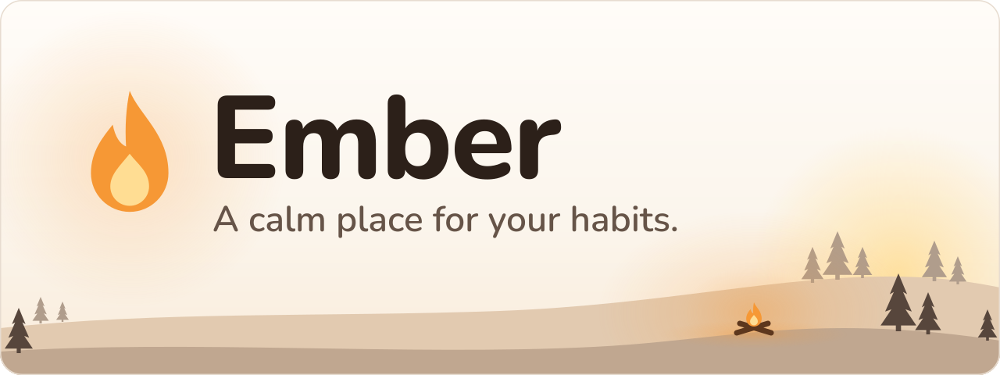
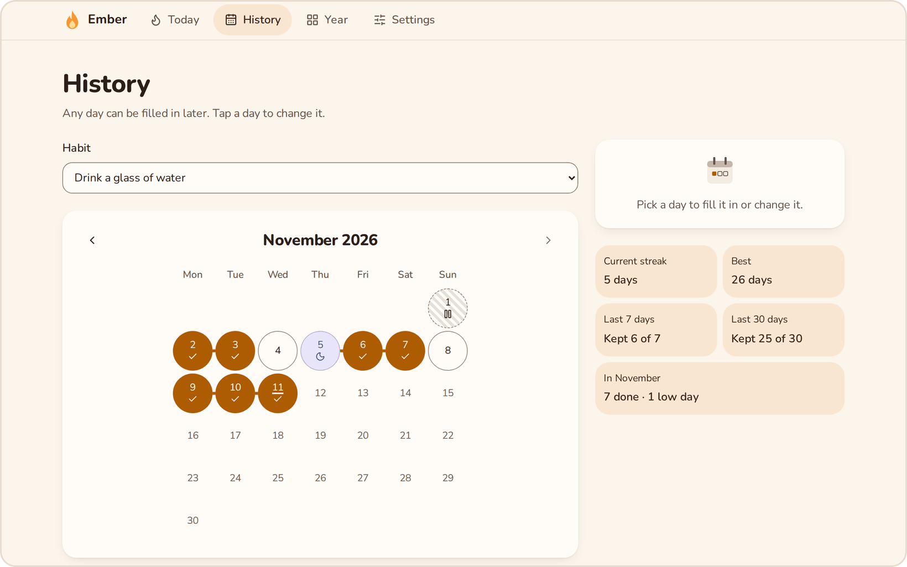
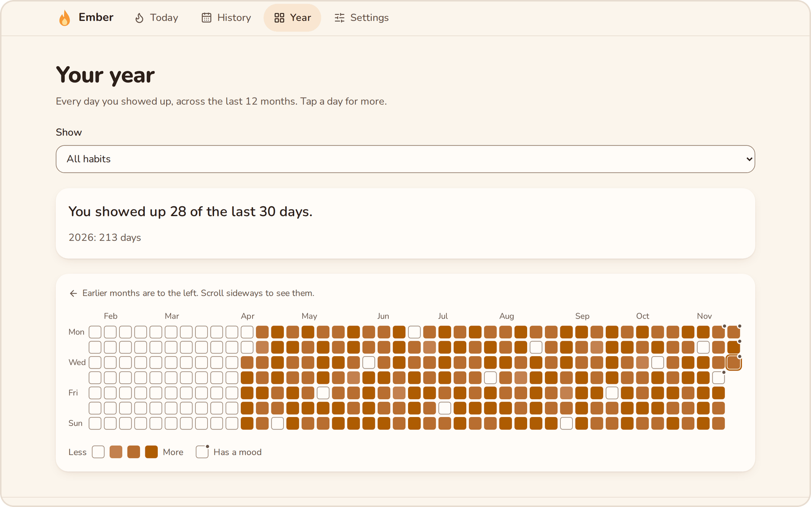
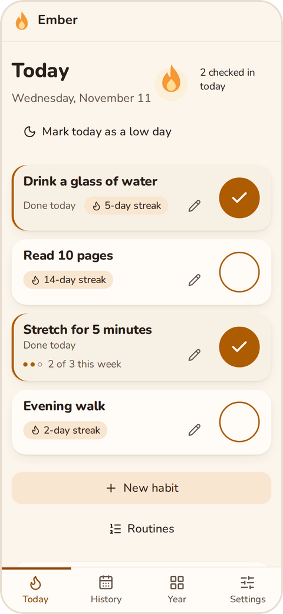
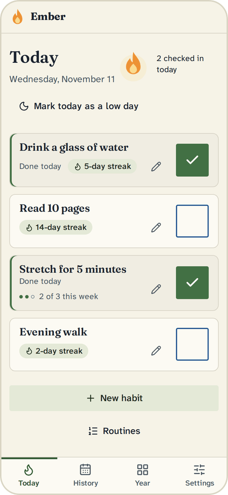
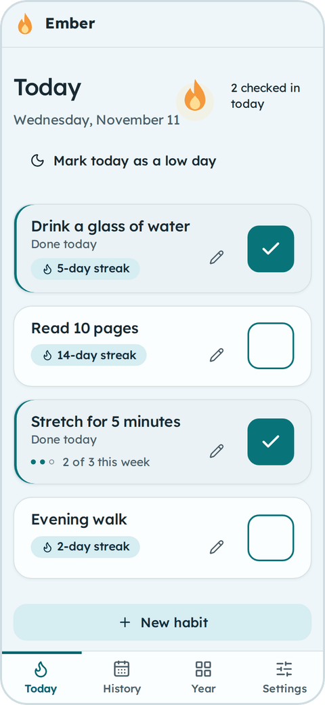
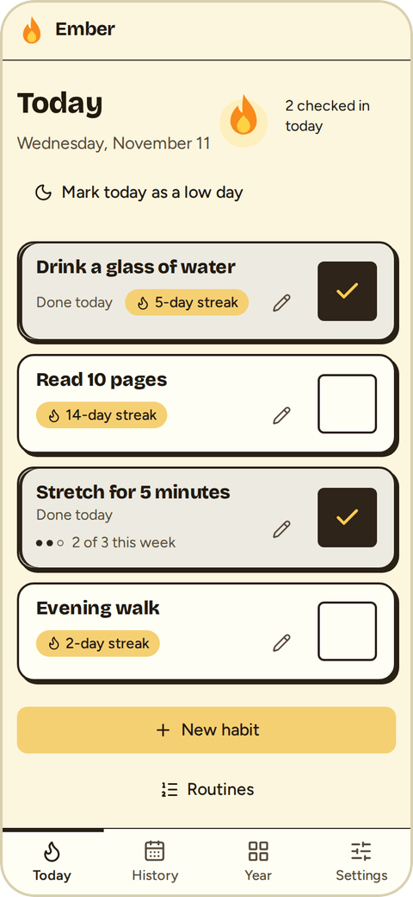

<picture>
  <source media="(prefers-color-scheme: dark)" srcset="docs/readme/banner-dark.svg">
  
</picture>

  
  
  

     

## What is Ember?

Ember is a habit tracker for people who find consistency hard, for example with ADHD, autism or executive dysfunction. Missing a day doesn't wipe out your progress, and Ember never scolds you for it.

Ember is a web app and an Android app. If you use Discord, you can add the Ember bot too. Use the same account everywhere and your habits and check-ins stay in sync, so a check-in on your phone shows up in the web app (and in Discord, if you use it).

Ember is in public beta at [beta.ember-glow.app](https://beta.ember-glow.app).

## Get Ember

| Way in | What it is | Get it |
|---|---|---|
| **Web app** | Runs in your browser. Sign in with email or Discord, or use it without an account on one device. | [beta.ember-glow.app](https://beta.ember-glow.app) |
| **Android app** | The web app as an Android app, with a home screen widget and phone reminders. It is an APK file from the download page, not a Google Play app. | [Download page](https://beta.ember-glow.app/download) |
| **Discord bot** (optional) | If you use Discord: slash commands and reminder DMs there. | [Download page](https://beta.ember-glow.app/download), which has the invite link |

On the web and in the Android app you create an account with an email address and a password, or sign in with Discord if you use it. An email address has to be confirmed before you can sign in. `/link` in Discord shows you how to open the web app. If you already have an email account, you can link Discord to it in Settings, and Ember offers to move your Discord habits over.

You can also use the web app and the Android app without an account. Your data then stays on that device.

## A look inside

  <picture>
    <source media="(prefers-color-scheme: dark)" srcset="docs/readme/history-dark.png">
    
  </picture>

**History** shows one habit by month. Tap a day to fill it in or change it. Beside the calendar you see the current streak, the last 7 and 30 days and the month's totals.

  <picture>
    <source media="(prefers-color-scheme: dark)" srcset="docs/readme/year-dark.png">
    
  </picture>

**History** also has a year view: the last 12 months as one heatmap, for all habits or for one habit.

## What makes it gentle

- 🔥 **Flexible streaks.** Pick how many unlogged days a week a streak can carry before it resets, from 0 to 3. Set it with `/habit grace` in Discord or in Settings on the web.
- 🌙 **Low days.** Mark a day as a low day. It covers all your habits: the streak neither breaks nor grows, and the day counts as kept in the 7 and 30 day views.
- ✏️ **Open days and backfill.** Today and yesterday stay open. Older days can be filled in later: the last 14 days in Discord, and back to the habit's start on the web.
- 📅 **Flexible schedules.** Daily, a weekly target of 1 to 6 times, specific weekdays, or up to 10 times a day for daily and weekday habits.
- ⏰ **Reminders where you are.** Discord DMs have **Done**, **Skip for today** and **Snooze 1h** buttons. Web push and Android notifications have a **Done** button for single habits. Reminders follow your local time, including across daylight saving changes.
- 🧭 **Routines.** Group habits into a routine with one reminder that lists only the habits still open that day. You set routines up on the web or in the Android app.
- ⏸️ **Pause.** Pause a habit for a set time. Reminders stop, and the streak is kept.
- 📨 **Gentle check-ins and a weekly recap.** In Discord, if a daily habit is still open for yesterday, Ember sends a DM at 10:00 your time. Every Sunday at 9:00 your time, you get a recap of the last 7 complete days. After a quiet week, the reminders are worded more softly.
- 🔒 **Private by default.** Only you see Ember's replies in Discord. `/habit share` is the one command that posts in a channel. The optional private journal is end-to-end encrypted on your device.

## Themes

Ember has four themes, each with a light and a dark version. Pick one in Settings under Appearance. The theme follows your account, and light or dark is set per device.

- 🕯️ **Hearthlight.** A candle-lit kitchen table: warm, soft, familiar. This is the default.
- 📓 **Fieldnotes.** A pocket notebook: grounded, quiet, literary.
- 🌊 **Tidepool.** A morning by the water: cool, airy, unhurried.
- 🌼 **Marigold.** A sticker sheet: playful, confident, high contrast.

  
  
  
  

The Today screen in Hearthlight, Fieldnotes, Tidepool and Marigold, all in light mode.

## Under the hood

Curious how it works, or want to run it yourself? The technical side lives in [TECHNICAL.md](TECHNICAL.md):

- ⌨️ [**Discord commands.**](TECHNICAL.md#discord-commands) Every slash command and how days, reminders and consent work.
- 🏠 [**Self-hosting.**](TECHNICAL.md#self-hosting) Run your own instance with Docker.
- 🛠️ [**Development.**](TECHNICAL.md#development) Code layout, builds and tests.
- 🧱 [**Tech stack.**](TECHNICAL.md#tech-stack) What Ember is built with.
- ⚖️ [**Legal.**](TECHNICAL.md#legal) Where the privacy policy, terms and imprint live.

## License

Custom non-commercial license, see [LICENSE](LICENSE).  
© 2026 Tzanto01. Non-commercial use only, credit required.
